<picture>
  <source media="(prefers-color-scheme: dark)" srcset="art/header-dark.svg">
  
</picture>

<h1>Hey there, I'm Keshav Gupta 👋</h1>

  
  
  

 

## 🙋 About Me

<table>
  <tr>
    <td width="65%" valign="middle">

**Computer Science Engineering graduate and Software Developer** based in **Haryana, India**.

I'm passionate about building **responsive web applications** and **data-driven solutions** that are fast, scalable, and genuinely useful. Currently I'm working on **FundScope India**, an AI-powered mutual fund analytics platform, and exploring **AWS cloud solutions** and scalable system design.

- 🔭 **Currently building:** FundScope India (AI-powered mutual fund analytics)
- 🌱 **Currently learning:** AWS cloud services and scalable system design
- 🤝 **Open to:** Internships, full-time roles, and collaboration on impactful projects
- ⚡ **Fun fact:** I've solved 100+ DSA problems on LeetCode and captained my university hostel cricket team to victory

    </td>
    <td width="35%" align="center" valign="middle">

    </td>
  </tr>
</table>

 

## 🛠️ Tech Stack

 

## 📊 GitHub Stats

  

 

## 🐍 Contribution Snake

<picture>
  <source media="(prefers-color-scheme: dark)" srcset="https://raw.githubusercontent.com/keshav062004/keshav062004/output/github-snake-dark.svg">
  <source media="(prefers-color-scheme: light)" srcset="https://raw.githubusercontent.com/keshav062004/keshav062004/output/github-snake.svg">
  
</picture>

<!-- Snake is generated by a GitHub Action (Platane/snk). Add .github/workflows/snake.yml to your repo to enable it. -->

 

## 📫 Connect With Me

  
  
  
  

 

