

  

  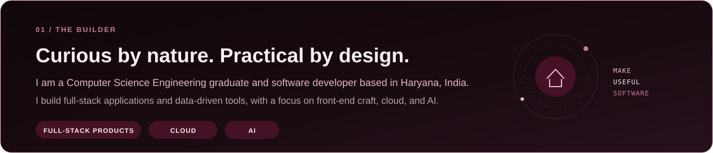

  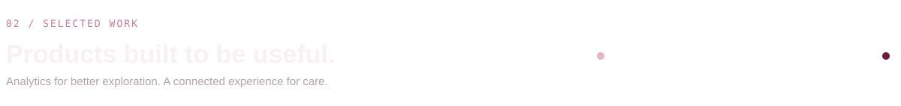

<a href="https://github.com/Keshav062004/FundScope-India">
  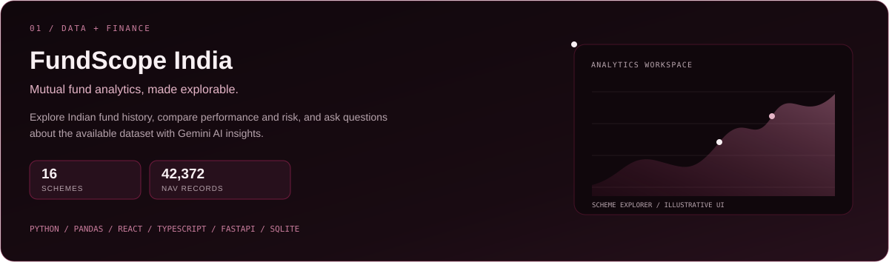
</a>

  
  &nbsp;
  

<a href="https://github.com/Keshav062004/MediConnect">
  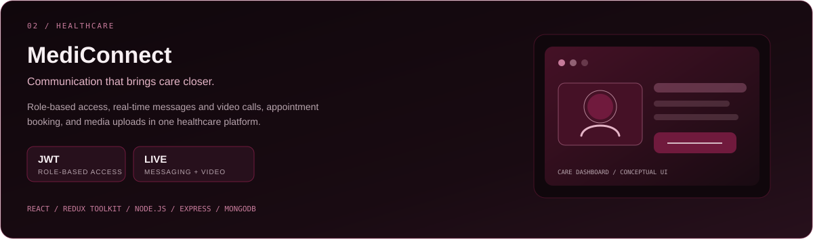
</a>

  
  &nbsp;
  

  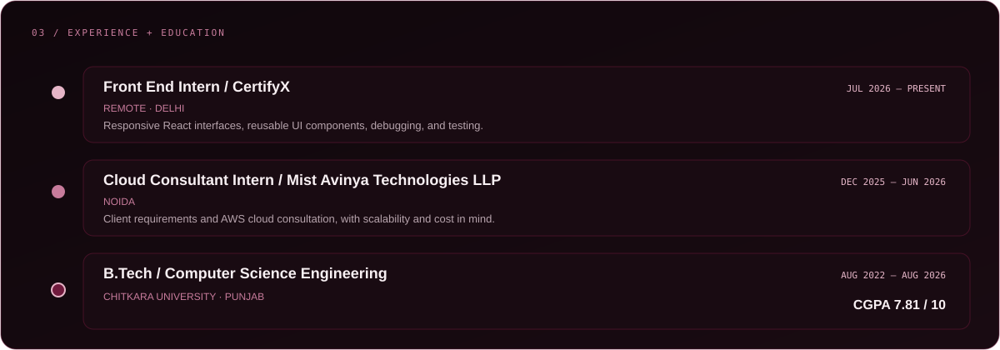

  <h2>Tech Stack &amp; Tools</h2>
  

  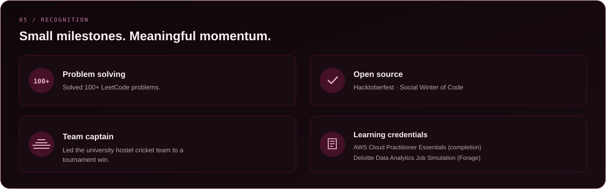

  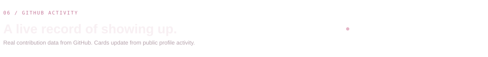

  

  

  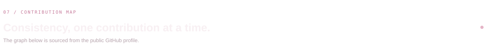

  

  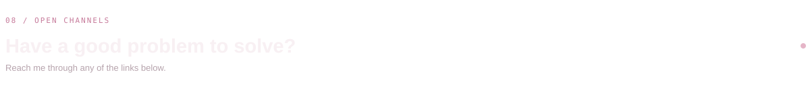

  
  
  
  

  

