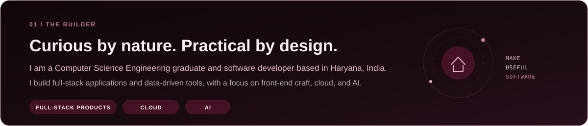
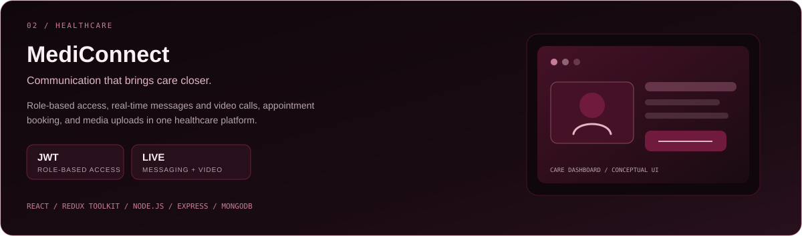
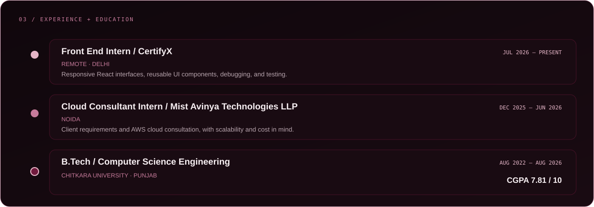
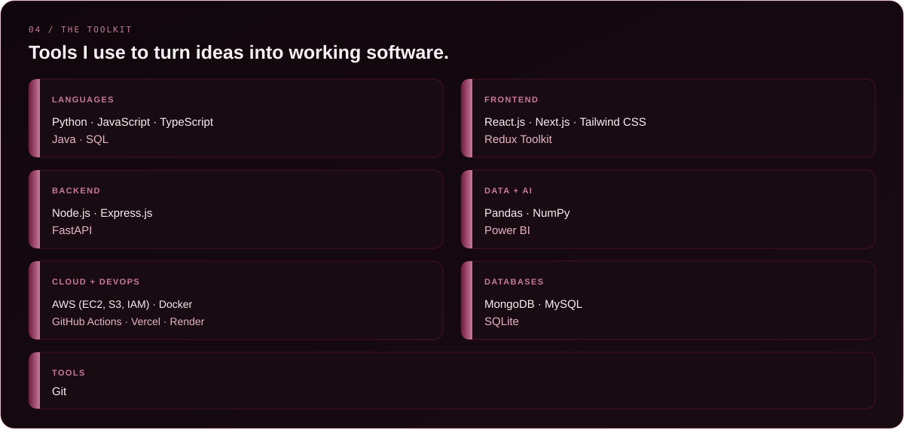
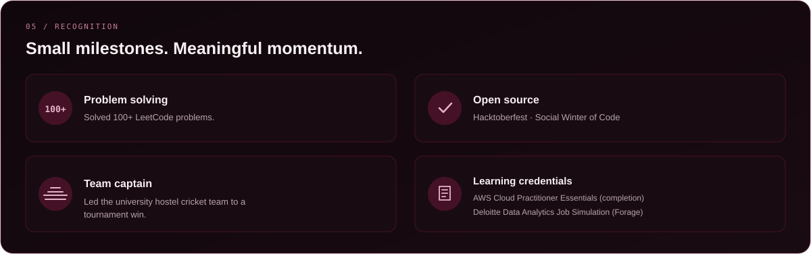

  

  

  

  <a href="https://fund-scope-india.vercel.app/">↗ Live app</a>
  &nbsp;·&nbsp;
  <a href="https://github.com/Keshav062004/FundScope-India">Source repository</a>

  <a href="https://medi-connect-k.netlify.app/">↗ Live app</a>
  &nbsp;·&nbsp;
  <a href="https://github.com/Keshav062004/MediConnect">Source repository</a>

  

  

  

  

  

  

  

  

  

  
  
  
  

  

